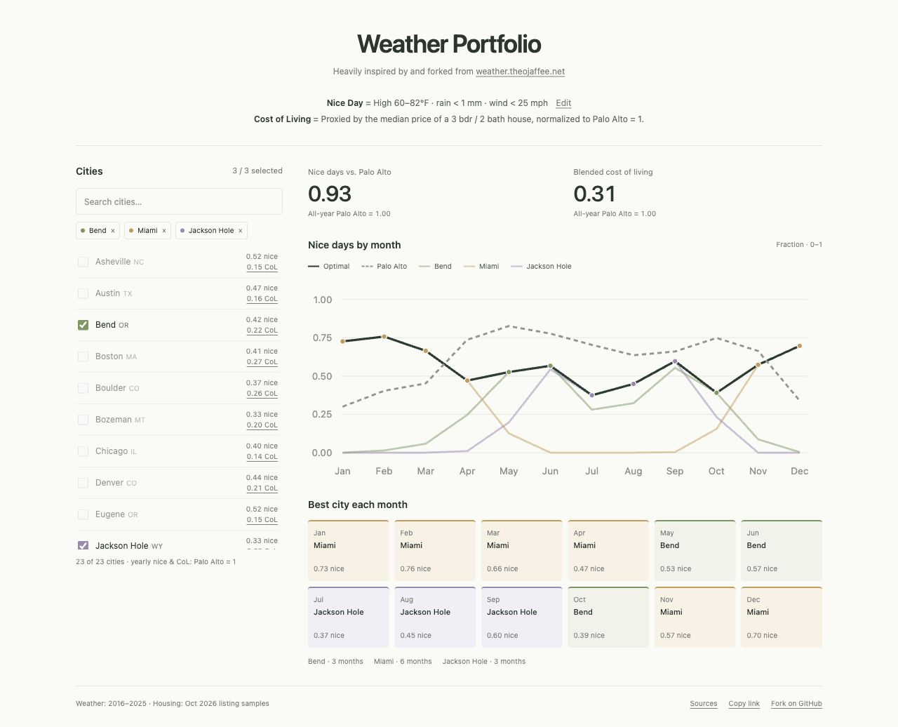

# Weather Portfolio

**Pick a few cities. Spend each month where the weather is nicest.**

[Open the app](https://alexpeys.github.io/weather_portfolio/index.html) · [Fork this project](https://github.com/alexpeys/weather_portfolio/fork) · [Weather Atlas](https://weather.theojaffee.net)

A small, static app for comparing a year split across **one, two, or three U.S. cities** with a full year in Palo Alto. Heavily inspired by and derived from [Theo Jaffee’s Weather Atlas](https://github.com/tjaffee99/weather).



## What it does

- Pick up to three of 23 cities; search also recognizes **NYC**, **Philly**, and **Jackson Hole**.
- Automatically choose the city with the **most nice days in each month**.
- Compare each city’s monthly curve, the optimal portfolio, and Palo Alto.
- See a month-by-month itinerary and two annual indices: **nice days** and **housing cost**, both normalized to **Palo Alto all year = 1.00**.
- Adjust the weather definition and share a portfolio with a link.

No account, server, API key, build step, or paid dependency is needed to run the app. Its data is included; calculations run locally in a Web Worker, and preferences stay in your browser.

## Run locally

Requires **Node.js 18+** for tests and **Python 3** for the local web server.

```sh
git clone https://github.com/alexpeys/weather_portfolio.git
cd weather_portfolio
npm run dev
```

Open [localhost:5173](http://localhost:5173). There are no npm dependencies to install.

```sh
npm test
```

The tests cover complete daily histories, temperature/rain/wind boundaries, monthly and yearly aggregation, housing medians, and optimal monthly assignments across all 2,024 pairs and triples. Representative portfolios are also checked against every possible monthly assignment.

## How the numbers work

### A nice day

By default, a historical day qualifies when all of these are true:

| Measure | Default |
| --- | --- |
| Daily high | **60–82°F**, inclusive |
| Total rain | **Under 1 mm** |
| Strongest wind from 9 am to 6 pm | **Under 25 mph** (40.2336 km/h) |
| Cloud cover | Any |

The app tests individual daily highs, not average temperatures. It counts qualifying days in each calendar month across **2016–2025**, then averages across the ten years. February 29 is excluded to make each comparison year 365 days.

The chart shows **monthly nice days ÷ days in that month**, on a 0–1 scale. Selected cities appear in color at 50% opacity, the optimal portfolio is dark green, and Palo Alto is dashed gray. The optimal line is the maximum selected-city value every month.

### Annual nice-day index

```text
Nice-day index = portfolio’s annual nice days / Palo Alto’s annual nice days
```

**1.00** matches living in Palo Alto all year; **1.20** means 20% more nice days; **0.85** means 85% as many. The city picker uses the same annual normalization. If the selected weather rules give Palo Alto zero nice days, the index is shown as unavailable instead of dividing by zero.

With the default rules, Palo Alto has **220.5 modeled nice days per year**. Changing the rules recalculates every city and the benchmark together.

### Cost-of-living proxy

```text
City CoL = sample median 3-bedroom / 2-bathroom asking price / Palo Alto’s median
Portfolio CoL = sum(city CoL × months spent there / 12)
```

Palo Alto is **1.00**; **0.30** means a housing-price level 30% of Palo Alto’s. It does not mean all living expenses are 70% lower or estimate the cost of buying multiple homes.

The housing snapshot uses **Redfin first-page listing samples retrieved October 11, 2026**, with exactly three bedrooms and two bathrooms. Matching addresses are deduplicated; nearby towns and 2.5-bath listings are excluded. New York includes its five boroughs, Boston includes official city neighborhoods, and Jackson Hole uses Jackson, Wyoming addresses.

**These are non-random asking-price samples, not comprehensive citywide sale medians.** All residential types returned by the source are included, with no adjustment for size, condition, HOA, or land tenure. Palo Alto’s sample median is **$2,939,000** from eight listings. Each city’s CoL value links to its source, and [housing.json](dist/housing.json) retains the observations and sample sizes.

### Choosing the months

Each month independently goes to the selected city with the greatest unrounded number of nice days. Housing price breaks exact weather ties; city ID breaks remaining ties. There is no minimum stay or moving penalty. You may return to a city, and a selected city may receive zero months.

## Cities

Austin · Denver · Boulder · Bend · Eugene · Miami · Minneapolis · Reno · Jackson Hole · Bozeman · Phoenix · Tucson · Las Vegas · Boston · Los Angeles · Santa Barbara · San Diego · Salt Lake City · Seattle · Asheville · New York · Philadelphia · Chicago

**Benchmark:** Palo Alto, California.

## Data and limitations

Weather comes from [Open-Meteo’s historical API](https://open-meteo.com/en/docs/historical-weather-api), using ERA5-Seamless: ERA5-Land temperature at 0.1° and ERA5 rain, wind, and clouds at 0.25°. Open-Meteo applies elevation downscaling and land-cell selection. Daytime metrics use the API’s local timezone and fixed UTC offset.

Every city contains **3,650 aligned daily records**. The fetcher validates dates, units, and missing values before replacing the dataset. These are modeled historical estimates, not station observations or forecasts; neighborhood microclimates, smoke, and air quality are not resolved.

The weather data and housing snapshots are bundled rather than fetched when someone opens the site. See [ATTRIBUTION.md](ATTRIBUTION.md) for provenance and data licensing.

## Make it your own

Fork the repository and edit:

| File | Purpose |
| --- | --- |
| `dist/index.html` / `dist/style.css` | Page and visual design |
| `dist/app.js` | Picker, chart, preferences, and sharing |
| `dist/engine.js` | Weather rules, housing indices, and monthly optimizer |
| `dist/worker.js` | Background calculations for selected cities |
| `dist/cities.json` | City catalog and coordinate provenance |
| `dist/climate.json` | Daily weather histories and source queries |
| `dist/housing.json` | Housing samples and source links |
| `scripts/fetch-history.py` | Rebuild the weather dataset |
| `test/engine.test.mjs` | Calculation and data checks |

To add a city, add its state-verified coordinates to `dist/cities.json`, fetch its weather, and add a matching exact 3-bed / 2-bath housing sample to `dist/housing.json`. Update the catalog assertions and combination counts in the tests. Weather histories and housing records must share the same city IDs; the app rejects missing data rather than inventing a fallback.

```sh
npm run extract
npm test
```

`npm run extract` downloads complete histories and may take several minutes. It respects API rate-limit errors and caches raw responses in ignored `.cache/history/`. Set `WEATHER_CACHE_DIR` to reuse another cache. Housing samples are maintained separately and are not refreshed by this command.

## Deploy

Copy the **contents of `dist/`** to any static host. All asset and data URLs are relative, so it also works in a subdirectory.

The live copy is published in the `weather_portfolio/` folder of [alexpeys/alexpeys.github.io](https://github.com/alexpeys/alexpeys.github.io). That Pages site already uses the custom domain `morelayers.ai`, so the GitHub Pages URL redirects to [morelayers.ai/weather_portfolio/index.html](https://morelayers.ai/weather_portfolio/index.html).

## License and credits

The original application code in this repository is **MIT licensed**; see [LICENSE](LICENSE). Third-party data retains its own terms and attribution requirements.

Thanks to [Theo Jaffee](https://github.com/tjaffee99) for [Weather Atlas](https://weather.theojaffee.net), and to Open-Meteo, ECMWF/Copernicus, GeoNames, and the housing listing sources. This public repository contains the portfolio app and bundled data; it does not redistribute Weather Atlas’s application source or assets.
